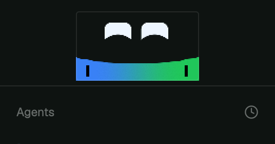

# Stick avatar for Herdr Desktop

The Stick sits just above **Agents** in the left sidebar. The eyes, Roman
numerals, and count transitions are rendered together, live, by the same
WebAssembly binary as the [Stick site](https://melnychuk.github.io/stick-s3/).
The image fits within **120 × 67.5 logical pixels** in a **76 px** slot and
shrinks with the sidebar. At 2× Retina scale, that is the Stick's native
240 × 135-pixel size. The renderer uses Herdr's sidebar color so the background blends
with the theme, and a thin theme-colored outline marks the display edge. With a
light theme (a light sidebar), the avatar switches to the Stick's light mode:
dark gray eyes and numerals with paler blue, green and yellow status colors.

On macOS and Linux, the widget appears when the physical Stick is unplugged.
When the Stick is detected over USB, Herdr collapses the slot and stops rendering
until it is unplugged again. Detection reads the OS's USB device list without
opening the serial port, so it works even if the bridge isn't running. The avatar
uses Herdr's own agent statuses and unread completions. When there
are no active, blocked or unread-done agents, the avatar stays awake while
Herdr is focused, dozes after about four seconds in the background, and wakes
when Herdr gets focus again. Activity takes priority over dozing.



## Install or upgrade

You need **Herdr Desktop** (`herdr-app`, tested with 0.1.13), **Node.js 20+**,
Python 3, and a checkout of this repository. Open Desktop once so it creates
the default layout, then run from the checkout:

```sh
python3 scripts/install-herdr-avatar.py
```

If you already installed the previous widget, upgrade it in place instead:

```sh
python3 scripts/install-herdr-avatar.py --upgrade
```

Select **stick-s3** in the Herdr Desktop layout picker, or run:

```sh
herdr-app do layout.switch '{"name":"stick-s3"}'
```

A fresh install copies the mod and the site's `avatar.wasm` to
`mods/stick-s3-avatar/` and creates `layouts/stick-s3.json` from `main.json`.
It does not change the shipped layout, switch layouts, or restart anything.
An upgrade backs up the old mod and your existing layout, then replaces the
mod and resizes only its widget block in that layout. Specify
`--name my-layout` to upgrade a different layout that already has the widget.
Use `--layout my-layout --name my-layout-with-stick` for a fresh copy of a
personal layout with a standard Agents sidebar. A fresh copy preserves
layout-file settings but not sizes or theme picks stored separately by Herdr.

The installer records your current Node executable so the desktop app can
launch it even if it wasn't started in a shell. Pass `--node /path/to/node`
to select a different Node install. The installer respects `HERDR_APP_HOME`
and `XDG_CONFIG_HOME`; `--app-home` specifies a different config directory.

By default, USB detection matches the Stick's ESP32-S3 USB ID (`303a:1001`). If
another ESP32 board also uses that ID, run the installer with
`--upgrade --usb-serial YOUR_STICK_SERIAL` to match only your Stick. On other
platforms, the widget stays visible because USB detection isn't implemented.

For other custom layouts, add this block immediately before Agents in your
personal layout's sidebar column after the installer has put the mod in place:

```json
{
  "id": "stick-s3-avatar",
  "type": "block",
  "size": { "px": 76 },
  "min": 0,
  "max": 76,
  "content": { "mod": "stick-s3-avatar" }
}
```

To remove it, switch back to your previous layout, then remove the installed
mod directory and layout copy (or just remove the block from a custom layout).

## How it works

Herdr supplies aggregate counts, focus, theme color and available width to a
local Node helper. It keeps one WASM instance alive across status changes and
streams its frames over a single loopback connection (`127.0.0.1`, guarded by a
one-time token), so nothing is written to disk while the Stick animates. The mod uses
native GPUI paths to display the frame without creating a cache entry for each
image. Rendering stays at the site's fixed 33 ms simulation step; Herdr presents
at up to 15 fps.

Each frame is redrawn as rectangles on Herdr's main thread, which costs time per
color and per rectangle. So the helper turns on two widget-only display options
in the renderer (`stick_set_display`; the site and the device never use them):
the status field is left undithered, and edge anti-aliasing is rounded to one
soft step, or to hard edges when a frame is busy. That keeps every frame at the
Stick's full 240 × 135 resolution for about half the main-thread time of the old
half-resolution fallback. Rectangles are packed in painter's order (large areas
first, smaller shapes on top). When working and done are both visible, Herdr
draws the blue-to-green field as native gradients. Extreme counts can still fall
back to a coarser grid for a few frames. Closing or switching away from the layout closes
the connection and stops the helper; if Herdr exits unexpectedly, the helper
stops on its own about five seconds after the mod stops sending input.

This is the site's live behavior, not full ESP32 emulation: the physical sketch
still has some of its own layout and sleep logic. The widget never acknowledges
completions or opens panes and doesn't use the network, hardware buttons, or audio.
